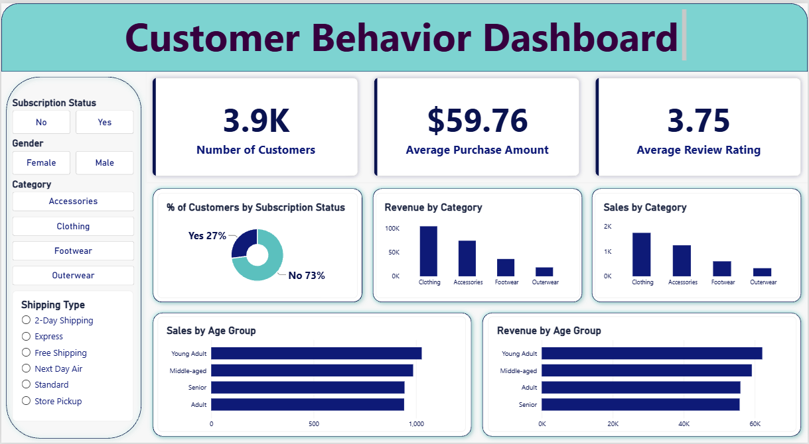

# Customer Shopping Behavior Analysis

## Overview

This end-to-end data analytics project explores customer shopping behavior to identify purchasing patterns, revenue drivers, and opportunities for improving customer engagement and business performance.

The project integrates Python, PostgreSQL, and Power BI to transform raw customer data into actionable business insights through data cleaning, exploratory data analysis, SQL analysis, and interactive visualization.

## Dataset

The dataset contains 3,900 customer records and 18 original variables, including:

- Customer demographics (age, gender, location)
- Purchase amount and product category
- Subscription status
- Purchase frequency and previous purchases
- Discount usage and shipping preferences
- Customer review ratings

The dataset was cleaned and transformed before being used for further analysis and visualization.

## Tools and Technologies

| Tool | Application |
|---|---|
| Python | Exploratory data analysis and data cleaning |
| Pandas | Data manipulation and feature engineering |
| SQL | Business analysis and data querying |
| PostgreSQL | Database management |
| Power BI | Data visualization and interactive dashboard |

## Project Workflow

### 1. Exploratory Data Analysis (Python)

- Loaded the dataset using Pandas.
- Examined data structure, data types, and descriptive statistics.
- Identified missing values and explored customer purchasing behavior.

### 2. Data Cleaning and Transformation

- Handled 37 missing review ratings using category-level medians.
- Standardized column names for consistency.
- Removed redundant data columns.
- Created customer age groups using quartile-based segmentation.
- Converted purchase frequency into numerical values for analysis.

### 3. Business Analysis (SQL and PostgreSQL)

Conducted 10 business queries to answer questions related to:

- Revenue contribution by gender and age group
- Customer spending and discount usage
- Highest-rated products
- Shipping preferences and purchase amounts
- Subscriber and non-subscriber spending behavior
- Customer segmentation and loyalty
- Top-performing products by category
- Repeat purchase behavior

SQL techniques used include:

- Aggregate functions
- GROUP BY and ORDER BY
- CASE WHEN statements
- Subqueries
- Common Table Expressions (CTEs)
- Window functions

### 4. Power BI Dashboard

Developed an interactive dashboard to visualize key business metrics and customer purchasing behavior.

The dashboard includes:

- Total number of customers
- Average purchase amount
- Average review rating
- Revenue and sales volume by category
- Revenue and sales volume by age group
- Customer subscription distribution
- Interactive filters for customer and product attributes

## Dashboard



[Download the Power BI Dashboard](customer_behavior_dashboard.pbix)

## Results and Key Insights

### Key Performance Indicators

| Metric | Result |
|---|---:|
| Total Customers | 3,900 |
| Total Revenue | $233,081 |
| Average Purchase Amount | $59.76 |
| Average Review Rating | 3.75 / 5 |
| Subscription Rate | 27% |

### Key Findings

- Clothing generated the highest revenue at $104,264, contributing approximately 44.7% of total revenue.
- Male customers accounted for approximately 67.7% of total revenue.
- Female customers had a slightly higher average purchase amount than male customers.
- Non-subscribers represented 73% of the customer base.
- Young adults, based on the project's quartile-defined age groups, generated the highest revenue among the four age groups.

### Business Recommendations

- Prioritize high-performing product categories in marketing and merchandising strategies, while considering profitability.
- Test targeted subscription incentives to encourage customer engagement and retention.
- Develop targeted marketing campaigns based on customer demographics and purchasing behavior.
- Evaluate promotional effectiveness to identify opportunities for improving sales performance.

These recommendations are based on descriptive analysis and would require further testing to establish their effectiveness.

## Project Files

| File | Description |
|---|---|
| customer_shopping_behavior.csv | Original customer dataset |
| customer_behavior.py | Python EDA and data-cleaning script |
| csbsql.sql | SQL business analysis queries |
| customer_behavior_dashboard.pbix | Interactive Power BI dashboard |
| dashboard.png | Dashboard preview |
| README.md | Project documentation |

## How to Run

1. Clone or download this repository.
2. Install Python and the required libraries:

   ```bash
   pip install pandas sqlalchemy psycopg2-binary
   ```

3. Run the Python script in interactive mode:

   ```bash
   python -i customer_behavior.py
   ```

4. Import the cleaned DataFrame into a PostgreSQL database as a table named `customer`.
5. Execute the queries in `csbsql.sql` individually using PostgreSQL or pgAdmin.
6. Open `customer_behavior_dashboard.pbix` using Power BI Desktop.
7. Update the database connection settings if necessary and refresh the dashboard.

## Skills Demonstrated

- Exploratory Data Analysis
- Data Cleaning and Preprocessing
- Feature Engineering
- SQL Querying
- Customer Segmentation
- Business Intelligence
- Dashboard Development
- Business Insight Generation

## Acknowledgments

This project was completed as a guided, hands-on learning project based on an end-to-end data analytics tutorial. It was undertaken to develop practical experience in Python, SQL, PostgreSQL, and Power BI and to understand how these tools are integrated into a business analytics workflow.

[Original YouTube Tutorial](https://www.youtube.com/watch?v=5PrZvPeUw60)
